2\
2.7 [Действие вычитания. Свойства вычитания](#22-действие-вычитания-свойства-вычитания)\
2.8 [Действие сложения. Свойство сложения](#21-действие-сложения-свойства-сложения)\
2.9 [Числовые и буквенные выражения](#23-числовые-и-буквенные-выражения)\
2.10.? [Вопросы]()\
2.11 [Уравнение](#24-уравнение)

3 Умножение и деление натуральных чисел\
3.12 [Действие умножения. Свойства умножения](#312-действие-умножения-свойства-умножения)
3.13 [Действие деления](#313-действие-деления)\
3.14 [Деление с остатком](#314-деление-с-остатком)\
3.15 [Упрощение выражений](#315-упрощение-выражений)\
3.16 [Порядок действий в вычислениях](#316-порядок-действий-в-вычислениях)\
3.17 [Степень с натуральным показателем](#317-степень-с-натуральным-показателем)\
3.18 [Делители и кратные](#318-делители-и-кратные)\
3.19 [Свойства и признаки делимости](#319-свойства-и-признаки-делимости)\

# 3 Умножение и деление натуральных чисел

## 3.19 Свойства и признаки делимости

Числа, которые делятся на 2, называются __четными__, а числа, которые не делятся на 2, называются __нечетными__.\
Числа 0, 2, 4, 6 и 8 - четные, а числа 1, 3, 5, 7 и 9 - нечетные.\

Свойства и признаки делимости помогают в вычислениях:
1. Если один из множителей делится на некоторое число, то и произведение делится на это число:
- 2400 = 24 * 100 = 24 * 25 * 4 = 25 * (24 * 4) = 25 * 96\
Значит число 2400 делится на 25 (2400 : 25 = 96)
1. Если каждое из двух чисел делится на некоторое число, то и их сумма и разность делится на это число:
- Проверим, делится ли сумма чисел (22, 55, 77) на 11, не выполняя деления:\
22 + 55 + 77 = 2 * 11 + 5 * 11 + 7 * 11 = (2 + 7 + 7) * 11 = 14 * 11\
Значит, сумма чисел делится на 11.
1. Если число оканчивается цифрой 0, то оно делится на 10:\
Любое натуральное число, запись которого оканчивается цифрой 0, делится без остатка на 10. Чтобы получить частное достаточно отбросить эту цифру 0:
- Найдем, какое из чисел (320 или 326) делится на 10. Число 320 можно представить в виде произведения: 32 * 10, и по свойству 1 оно делится на 10.
1. Натуральное число, которое оканчивается другой цифрой, не 0, не делится без остатка на 10. Остаток в этом случае равен последней цифре числа:
- 326 : 10 = 32 (ост. 6): шесть - последняя цифра записи этого числа
1. Если число оканчивается цифрой 0 или 5, то оно делится на 5. Если же запись числа оканчивается иной цифрой, то число без остатка на 5 не делится:
- 1870 = 187 * 10 = 187 * (2 * 5) = (187 * 2) * 5;
- числа (630 и 635) делятся на 5 без остатка;
- а числа (632 и 633) не 5 без остатка не делятся;
1. Если число оканчивается четной цифрой, то оно делится на 2. Число, которое оканчивается нечетной цифрой, не делится на 2:
- Числа (2, 30, 96, 208) четные, те делятся на 2, а числа 3, 41, 117, 309 - нечетные, те не делятся на 2.
1. Число делится на 9, если сумма цифр этого числа делится на 9. Число не делится на 9, если сумма цифр этого числа не делится на 9:
- 976644 делится на 9 тк сумма его цифр: 9 + 7 + 6 + 6 + 4 + 4 = 36 делится на 9;
- а число 72 385 не делится, так как сумма его цифр не делится на 9: 6 + 2 + 3 + 8 + 5 = 25 не делится на 9.
1. Число делится на 3, если сумма цифр этого числа делится на 3. Число не делится на 3, если сумма цифр этого числа не делится на 3.
9.Число, которое оканчивается нечетной цифрой, не делится на 2:
- числа 2, 30, 96, 208 - четные;
- числа 3, 41, 117, 609 - нечетные.

## 3.18 Делители и кратные

Говорят, что натуральное число m делится без остатка, на натуральное число n, если есть такое натуральное число а, что m = n * a.\
Натуральное число n называется __делителем__ натурального числа m, а число m - __кратным__ числа n.\
Например, можно сказать: 6 - делитель 24 или 24 - кратное 6.

У числа 17 два делителя: 1 и 17.\
Натуральное число называется __простым__, если оно имеет только два делителя: единицу и само это число.

У числа 36 девять делителей: 1, 2, 3, 4, 6, 9, 12, 18, 36.\
Натуральное число, у которого более двух делителей, называют __составным__.

Считают, что единица не является ни простым, ни составным числом.

Если число представлено в виде произведения чисел, то говорят, что оно __разложено на множители__:\
36 = 1 * 36 = 2 * 18 = 3 * 12 = 4 * 9 = 6 * 6 = 2 * 3 * 6

Число 1 является делителем любого натурального числа.

У любого натурального числа кратных бесконечно много.\
Наименьшим из кратных числа является само это число.\
Например, первые три числа, кратные 12: 12, 24, 36.

Каждое из чисел 6, 28, 496 равно сумме всех его делителей, не считая самого числа. Такие числа называют __совершенными__:
- 1 + 2 + 3 = 6;
- 1 + 2 + 4 + 7 + 14 = 28;
- 1 + 2 + 4 + 8 + 16 + 31 + 62 + 124 + 248 = 496.

### Правила русс. Кратное

1. Правильно употребляйте слова кратно и кратное (в значении существительного).
- Кратно (какому числу?): число восемь кратно числу четыре(Д.п.) или восемь кратно четырем (Д.п);
- Кратное (какого число?): число восемь - кратное числа четыре (Р.п.), или восемь - кратное четырех (Р.п.), число восемь, двенадцать, шестнадцать - кратные четырех(Р.п.).
2. Слово "делитель" употребляется с родительным падежом зависимого слова, например:
- число пять - делитель числа десять (Р.п.), или пять - делитель десяти (Р.п.);
- делитель тринадцати(Р.п.) - числа один и тринадцать.
3. Слова делится (без остатка) и кратно заменяют друг друга:
- сорок восемь делится на три;
- сорок восемь кратно трем.

В этимологическом словаре русского языка сказано, что слово кратное произошло от старославянского слова крать, означающего раз.\
В толковом словаре сказано, что кратное означает повторяющийся столько-то раз. Например, семикратный, многократный.

### Понятие. Комбинаторика

Когда мы перебрали все возможные способы и все возможные __комбинации__, такие задачи называют __комбинаторными__, а область математики - __комбинаторикой__.

## 3.17 Степень с натуральным показателем

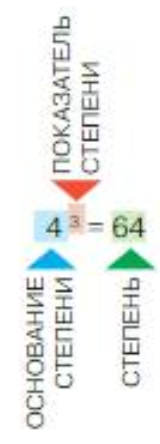\
C помощью произведения удобно записать сумму равных слагаемых: 4 + 4 + 4 + 4 + 4 = 4 * 5, - число 5 показывает, сколько слагаемых было сумму.\
Произведение равных множителей тоже можно записать по-другому:\
3 * 3 * 3 * 3 * 3 = 3^5\
Степенью числа "a" с натуральным показателем "n", большим 1, называется произведение "n" одинаковых множителей, каждый из которых равен числу "a".\
В записи 3^5 число 3 называют __основанием степени__, число 5 - __показателем степени__, а выражение 3^5 называют __степенью числа__.\
Показатель степени показывает сколько множителей было в произведении.

Вторую степень числа часто называют квадратом числа: 6 * 6 называют "квадратом числа 6" и обозначают 6^2.

Квадратом числа n называют произведение n * n и обозначают n^2(читают "эн в квадрате"):\
n^2 = n * n

Третью степень числа называют __кубом числа__.\
Кубом числа n называют произведение n * n * n и обозначают n^3(читают эн в кубе): n^3 = n * n * n.

Первую степень числа считают равной самому числу: 17^1 = 17, 1^1 = 1. Показатель степени 1 обычно не пишут.

Возведение числа в степень - это пятое арифметическое действие. Если числовое выражение не содержит скобок и в него входят степени чисел, то сначала вычисляют их значения.

Любое многозначное число можно представить в виде __суммы разрядных слагаемых__:\
7635 = 7 * 10^3 + 6 * 10^2 + 3 * 10 + 5.

### Правила русс. Степень

Выражение 3^5 читают: "три в пятой степени" или "пятая степень числа три"\
Число 10^100 называют гугол. Название именно этого числа было выбрано для всемирной поисковой системы.

## 3.16 Порядок действий в вычислениях

__Действиями первой ступени__ называют сложение и вычитание чисел, а __действиями второй ступени__ - умножение и деление чисел.\
При вычислении значений выражений __порядок(алгоритм) выполнения действий__ определяют следующие правила:
1) Если выражение содержит только действие одной ступени и в нем нет скобок, то действия выполняются по порядку слева направо;
2) Если в выражении нет скобок, то сначала выполняют действия второй ступени, потом - действия первой ступени;
3) Если в выражении есть скобки, то сначала выполняют действия в скобках.

В выражениях, содержащих скобки, можно эти скобки не писать(опускать), если при этом порядок действий не изменяется: (67 - 41) + 13 - 11 = 67 - 47 + 13 - 11.\
Используя свойства сложения, вычитания и умножения, можно изменять порядок действий.\
Каждое выражение задает __алгоритм__ своего вычисления. Он состоит из __команд__.\
Этот алгоритм вычислений можно представить в виде __схемы__.
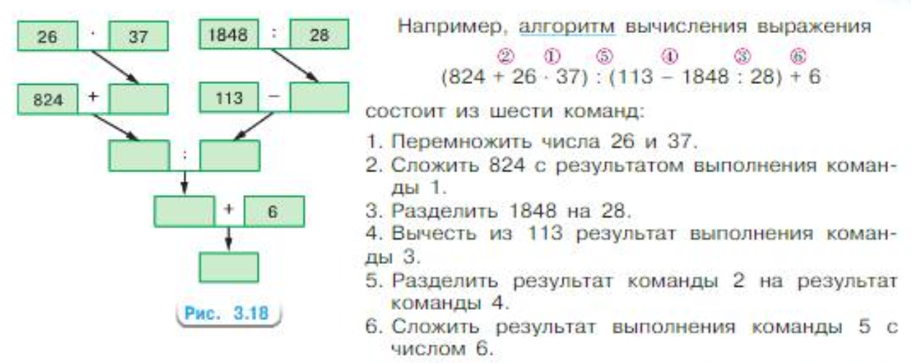

## 3.15 Упрощение выражений

### Распределительное свойство умножения относительно сложения

__1.Распределительное свойство умножения относительно сложения__. Чтобы сумму умножить на число, можно умножить каждое слагаемое на это число и полученные произведения сложить:\
(a + b)c = ac + bc.\
Распределительное свойство верно для любого числа слагаемых:\
(2 + 6 + 7 + 9) * 8 = 2 * 8 + 6 * 8 + 7 * 8 + 9 * 8.

### Распределительное свойство умножения относительно вычитания

__2. Распределительное свойство умножения относительно вычитания__. Чтобы разность умножить на число, можно умножить уменьшаемое и вычитаемое на это число и из первого произведения вычесть второе:\
(a - b)c = ac - bc.\

Распределительное и сочетательное свойства умножения применяют для упрощения выражений.

4с + 5с = 9с: "Четыре цэ плюс пять цэ равно девяти цэ"\
25y - 14y = 11y: "Двадцать пять игрек минус четырнадцать игрек равно одиннадцати игрек"

Примеры:
- Упросить выражение: 3t * 6 * 10: Применив [сочетательное](#312-действие-умножения-свойства-умножения) свойство умножения, получим: 3t * 6 * 10 = (3 * 6 * 10)t = 180t;
- Найдем корень уравнения: 6х + 4х + 32 = 92: Применив [распределительное](#распределительное-свойство-умножения-относительно-сложения) свойство умножения, получим 6х + 4х = 10х, можно записать 10х + 32 = 92, 10х = 92 - 32, 10х = 60, х = 60:10, х = 6.\
Проверка: 6 * 6 + 4 * 6 + 32 = 92 - верно.

### 3.15 Примеры

1.Объясните решение:\
13 * 5 = (10 + 3) * 5 = 10 * 5 + 3 * 5 = 50 + 15 = 65.
1) раскладываем число 13 на разрядные слагаемые 10 и 3;
2) умножаем каждое слагаемое на 5, используя распределительное свойство умножения относительно сложения;
3) складываем полученные произведения.

4. Объясните решение:\
29 * 4 = (30 - 1) * 4 = 30 * 4 - 1 * 4 = 120 - 4 = 116.
1) представляем число 29 в виде разности 30 и 1;
2) умножаем уменьшаемое и вычитаемое на 4, используя распределительное свойство умножения относительно вычитания;
3) из первого произведения вычитаем второе.

## 3.14 Деление с остатком

Деление одного натурального числа на другое нацело не всегда возможно.\
В этом случае говорят о __делении с остатком__ числа.\
Формула:
- a : b = q (ост r) где a - __делимое__, b - __делитель__, q - __неполное частное__, r - __остаток__; 
- a = bq + r: чтобы __найти делимое а при делении с остатком__, надо делитель b умножить на неполное частное q и прибавить остаток r.\
Если остаток равен 0, то делимое делится нацело на делитель.
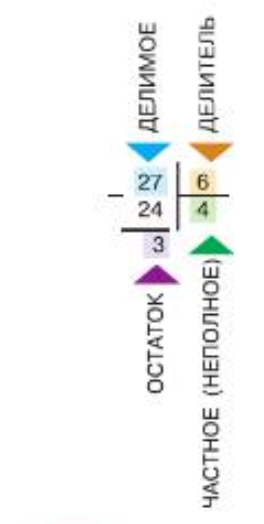

## 3.13 Действие деления

Действие деления определяется с помощью действия умножения.\
__Деление__ - это действие, с помощью которого по произведению и одному из множителей находят другой множитель.\
Формула: a : b = c.\
Число а, которое делят, называется __делимым__; число b, на которое делят, называют __делителем__. Число с, которое получают в результате деления, называют __частным__;. Частное показывает, во сколько раз делимое больше делителя.\
Запись вида a:b называют __частным__.\
Так как 1 * a = a, то по смыслу действия деления имеем a:1=a и, если а не равно нулю, a:a = 1.\
Для любого натурального числа a верны равенства:
- a:1 = a;
- a:a = 1;
- 0:a = 0.

Ни одно число нельзя делить на нуль.\
Например, частного 6:0 не существует, так как при умножении любого числа на 0 получаем 0, а не 6. Нуль нельзя разделить на 0, так как любое число при умножении на 0 дает 0, а значит, нельзя однозначно записать результат такого деления.\
1. Чтобы __найти неизвестный множитель__, надо произведение разделить на известный множитель: 8х = 112, х = 112:8;
2. Чтобы __найти неизвестное делимое__, надо делитель умножить на частное: х:9 = 12, х = 9 * 12;
3. Чтобы __найти неизвестный делитель__, надо делимое разделить на частное: 56:x = 8, x = 56:8.

## 3.12 Действие умножения. Свойства умножения

Сумму равных слагаемых: 15 + 15 + 15 + 15 = 60, можно записать короче: 15 * 4 = 60.\
Где выражение: 15 * 4 и его значение 60 называют __произведением__ чисел 15 и 4, а сами числа - __множителями__.\
__Умножить число а на натуральное число b__ - значит найти __сумму b__ слагаемых, каждое из которых равно a.\
Выражение a * b и значение этого выражения называют __произведением__ чисел а и b. Числа а и b называют __множителями__.\
Сумма n слагаемых, каждое из которых равно 1, равна n: 1 * n = n.\
Сумма n слагаемых, каждое из которых равно 0, равна нулю: 0 * n = 0.\

Свойства:
1.__Переместительное свойство__. От перестановки множителей произведение двух чисел не меняется: a * b = b * a.\
2.__Сочетательное свойство__. Чтобы умножить произведение двух чисел на число, можно первое число умножить на произведение второго и третьего чисел: (a * b) * c = a * (b * c).\
Знак умножения обычно не пишут перед буквенными множителями и перед скобками\
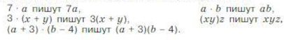

### Правила русского

Произведение читают, называя каждый множитель в родительном падеже:
- 162 * 50 - произведение ста шестидесяти двух и пятидесяти;
- 70 * (x + 8) - произведение семидесяти и суммы "икс" и восьми.

Вместо слов "представь в виде произведения число" говорят __разложите на множители число__.

## 2.11 Уравнение

Выражения, соединенные знаком "=", образуют __равенство__. Равенства могут быть __верными__ (2 + 3 = 5) и __неверными__ (2 + 3 = 7).\
Задача. На одной чаше весов лежит рюкзак и гири общей массой 3 кг, а на другой чаще - гиря массой 7 кг. Чему равна масса рюкзака, если весы находятся в равновесии?\
Решение: Обозначим буквой z неизвестную массу рюкзака, тогда на правой части весов (z + 3) кг. И весы находятся в равновесии, поэтому должно выполняться равенство z + 3 = 7.\
Эти рассуждения при решении задачи называют составлением __математической модели__(текст задачи переводят с обычного языка на язык математическии).\
Найдем значение z, при котором равенство z + 3 = 7 будет __верным__.\
Равенство, содержащее букву, может быть верным при одних значениях буквы и неверным при других ее значениях.\
Равенство, содержащее неизвестное число, обозначенное буквой, называют __уравнением__.\
Корнем уравнения называют значение буквы, при котором уравнение становится верным числовым равенством.\
__Решить уравнение__ - значит найти все корни (или убедиться, что это уравнение не имеет корня).\
Решение уравнения - это работа с математической моделью. При составлении математической модели можно сделать анализ в виде схемы, таблицы, краткой записи.
1. Чтобы __найти неизвестное слагаемое__, надо из суммы вычесть известное слагаемое: х + 14 = 56, х = 56 - 14.
2. Чтобы __найти неизвестное уменьшаемое__, надо сложить вычитаемое и разность: у - 12 = 9, у = 9 + 12.
3. Чтобы __найти неизвестное вычитаемое__, надо из уменьшаемого вычесть разность: 18 - а = 7, а = 18 - 7.
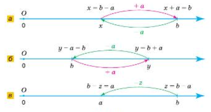

### Правила чтения

В уравнении и буквенном выражении читают названия латинских букв x, y, z в мужском роде, а остальных букв - в среднем роде. В математике склонять названия букв не принято.\
Например:
- n + 47 = 60 - сумма "эн" и сорока семи равна шестидесяти;
- n = 13 - "эн" равно тринадцати;
- x - 17 = 22 - разность "икс" и семнадцати равна двадцати двум;
- x = 39 - "икс" равен тридцати девяти.

## 2.3.? Вопросы

Закономерность - это правило расположения любых предметов и чисел в ряду, таблице и тд

Отличие отрезка и прямой: Отрезок - часть прямой, отрезок ограничен с двух сторон, прямая не ограничена\
Отрезок и луч: отрезок и луч - части прямой, отрезок ограничен с двух сторон, луч ограничен с одной стороны.\
Лучи и прямая: луч - часть прямой, луч ограничен с одной стороны, прямая не ограничена

## 2.3 Числовые и буквенные выражения

Используя знаки арифметических действий и скобки, из чисел составляют числовые выражения.\
Вычислив 2 + 3 = 5, произведя вычисление, мы получили число 5, которое является __значением__ это __выражения__.\
__Значением числового выражения__ называют число, которое получают в результате выполнения действия в этом выражении.\
Можно получить новые задачи, если обозначить в условии число, которое мы меняем, буквой, например "р".\
Подставив вместо буквы "р" например число 4, получим числовое выражение для решения первой задачи. Подставив 5, получим числовое выражение для решения второй задачи.
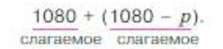\
__Буквенным выражением__ называют выражение, содержащее буквы. В буквенном выражении буквы могут обозначать различные числа. Числа, которыми заменяют буквы, называют __значениями__ этой __буквы.__\
Свойства сложения и вычитания можно записать с помощью букв.\
Для любых натуральных чисел и нуля верны свойства сложения 1-3.\
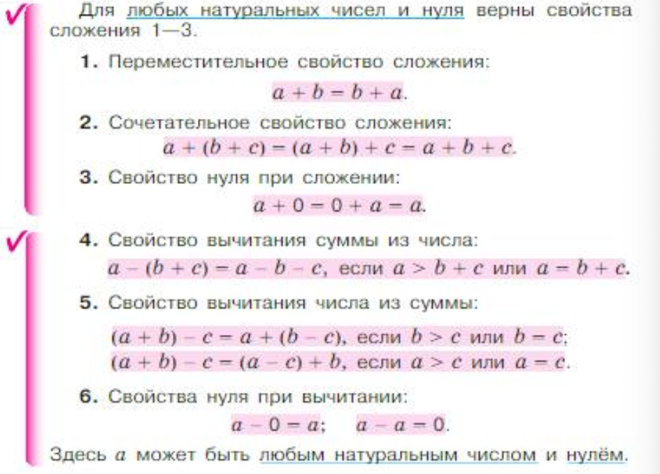\

### Правила

Выражение (m + 5) + (n - 9) можно прочитать так:
- сумма выражения "m плюс 5 " и выражения "n минус 9";
- сумма суммы m и 5 и разность n и 9.

## 2.2 Действие вычитания. Свойства вычитания

__Вычитание__ - это действие с помощью которого по сумме и одному из слагаемых находят другое слагаемое.\
Число, из которого вычитают (которое уменьшают), называется __уменьшаемым__, а число которое вычитают, - __вычитаемым__.\__
Число, которое получают в результате вычитания, называют __разностью__.\
Уменьшаемое должно быть больше вычитаемого ил равно еу при действии с натуральными числами и нулем.\
__Разность__ двух чисел показывает, на сколько первое число больше второго или на сколько второе число меньше первого.\
Разность 5 и 8 показана на координатной прямой.
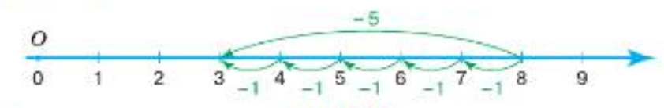\
На координатной прямой также удобно иллюстрировать __свойства вычитания__.
1. __Свойство вычитания суммы из числа__. Чтобы вычесть сумму из числа, можно вычесть из этого числа одно слагаемое, а затем из полученной разности другое слагаемое.\
Например:
- 11 - (2 + 4) = 11 - 6 = 5;
- (11 - 2) - 4 = 9 - 4 = 5.
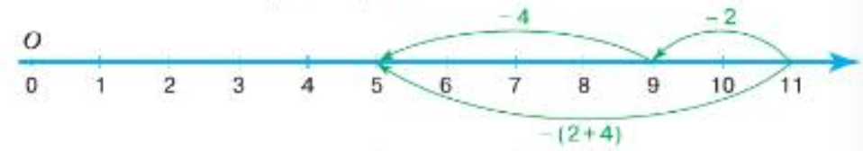
1. __Свойство вычитания числа из суммы.__ Чтобы вычесть число из суммы, можно это число вычесть из любого слагаемого и к полученной разности прибавить другое слагаемое:
- (6 + 4) - 2 = 10 - 2 = 8;
- 6 + (4 - 2) = 6 + 2 = 8;
- (6 - 2) + 4 = 4 + 4 = 8.
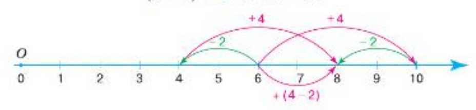\
Конечно, вычитаемое число должно быть меньше числа, из которого его вычитают, или равно ему.\
Из свойства нуля при сложении следуют его свойства при вычитании:
- 7 + 0 = 7;
- 7 - 0 = 7;
- 7 - 7 = 0;
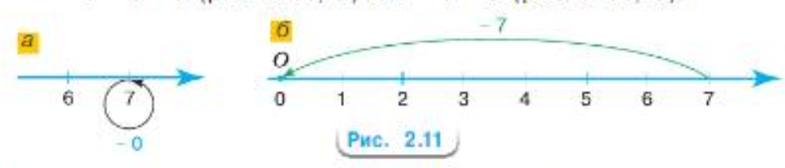
1. При вычитании нуля число не изменится.
2. При вычитании равных чисел получится нуль

## Правила

Читая разность, следите за правильным сочетанием предлогов и глаголов:
- предлог __из__ употребляется с глаголом __вычесть__;
- предлог __от__ употребляется с глаголом __отнять__;
Пример:
- 1053 - 78; из тысячи пятидесяти трех вычесть семьдесят восемь;
- 1051 - 44; от тысячи пятидесяти одного отнять сорок четыре;

## 2.1 Действие сложения. Свойства сложения

Прибавив к натуральному числу единицу, мы получим следующее за ним число. Например: 8 + 1 = 9; 999 + 1 = 1000.\
Чтобы сложить числа 6 и 2, нужно к числу 6 прибавить два раза единицу: 6 + 2 = 6 + 1 + 1 = 7 + 1 = 8.\
Число, которое получают в результате сложения чисел, называют __суммой__. Числа, которые складывают, называют __слагаемыми__.\
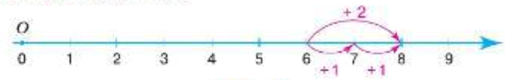\
Действие сложения чисел можно показывать на координатной прямой.\
На координатной прямой удобно иллюстрировать __свойства сложения__.
1. __Переместительное свойство__. Сумма чисел не меняется при перестановке слагаемых: 3 + 2 = 5 и 2 + 3 = 5
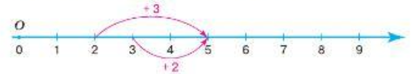
1. __Сочетательное свойство__. Чтобы к числу прибавить сумму двух чисел, можно сначала прибавить первое слагаемое, а потом к полученной сумме - второе слагаемое.\
Например: 
- 2 + (1 + 3) = 2 + 4 = 6
- (2 + 1) + 3 = 3 + 3 = 6
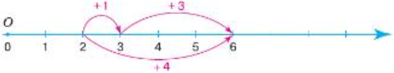
1. Число не меняется при сложении с нулем.\
Например: 5 + 0 = 5. По переместительному свойству сложения имеем 5 + 0 = 0 + 5.\
Сумму нескольких слагаемых можно записать без скобок:
- (4 + 9) + 8 = 4 + 9 + 8 = 21
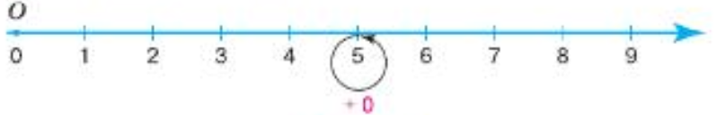

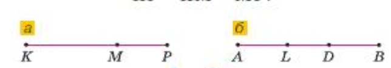
Точка М лежит на отрезке КР, поэтому длина отрезка КР равна сумме длин его частей КМ и МР: КР = КМ + МР.\
Длину отрезка АВ можно записать различными способами: \
AB = AL + LD + DB = AL + LB = AD + DB.

В числе 9806 содержится 9 тысяч, 8 сотен, 0 десятков и 6 единиц. Это можно записать так:\
9806 = 9 * 1000 + 8 * 100 + 0 * 10 + 6 * 1\ = 9 * 1000 + 8 * 100 + 6
Такое представление числа называется разложение этого числа по разрядным слагаемым.

При чтении суммы и разности чисел вместо знаков + и - говорят "сумма" и "разность", а числа читают в родительном падеже:
- 24 + 76 - сумма двадцати четырех и семидесяти шести;
- 235 - 97 - разность двухсот тридцати пяти и девяноста семи.
