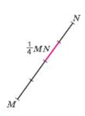
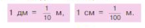
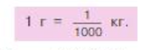
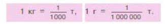
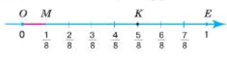

# 5 Обыкновенные дроби

5.25 [Окружность, круг, шар, цилиндр](#525-окружность-круг-шар-цилиндр)\
5.26 [Доли и дроби. Изображение дробей на координатной прямой](#526-доли-и-дроби-изображение-дробей-на-координатной-прямой)\
5.27 [Сравнение дробей]()\
5.28 [Правильные и неправильные дроби](#528-правильные-и-неправильные-дроби)\
5.29 [Сложение и вычитание дробей с одинаковыми знаменателями](#529-сложение-и-вычитание-дробей-с-одинаковыми-знаменателями)

## 5.26 Доли и дроби. Изображение дробей на координатной прямой

Часто приходится делить целое (яблоко или пирог) на части. Например, дыню разрезали на 7 равных частей. Эти равные части называются __долями__. Так как мы разделили целое на 7 долей, то каждая часть - это одна седьмая доля (дыни, числа). Обозначается как 1/7 дыни.

Длина отрезка MN равна 4 см. Следовательно, 1 см составляет 1/4 отрезка MN.

Слова полчаса, треть пути, четверть метра используются в жизни ежедневно.\
Долю 1/2 называют __половиной__, 1/3 - __третью__, а 1/4 - __четвертью__.\

Когда мы взяли не одну часть 1/5 а 2 части, то говорим 2/5.\
Запись вида 2/5 называют __обыкновенными дробями__. Обыкновенные дроби записывают двумя натуральными числами, разделенными дробной чертой, в виде a/b. В дроби a/b число a называется __числителем__ дроби, а число b - __знаменателем__ дроби.\
Числитель дроби пишут над чертой, а знаменатель - под чертой.\
Знаменатель показывает, на сколько долей разделено целое, а числитель - сколько таких долей взято.

Так как 1 м = 10 дм = 100 см, то:
- 1 дм = 1/10 м;
- 1 см = 1/100 м.

Так как 1 кг = 1000 г, то:
- 1 г = 1/1000 кг.

Так как 1 т = 1000 кг = 1 000 000 г, то:

Как и натуральные числа, дроби можно изобразить на координатной прямой. Отрезок OM равен 1/8 единичного отрезка OE.\
Точка К изображает число 5/8. Число 5/8 является координатой точки К, и пишут: К(5/8).

### Правила чтения дробей

Дроби читают так: 
1) числитель дроби как количественное числительное женского рода
- одна, две, восемь и т.д.
2) знаменатель дроби как порядковое числительное:
- седьмая, сотая, вторая, двести тридцатая\
Например:
- 1/6 одна шестая;
- 2/7 две седьмых;
- 5/1000 пять о тысячных;
- 73/354 семьдесят три триста пятьдесят четвертых;
- 15/347 пятнадцать триста сорок седьмых;
- 75/90000 семьдесят пять девяносто тысячных;
- 2/4 две четверти;
